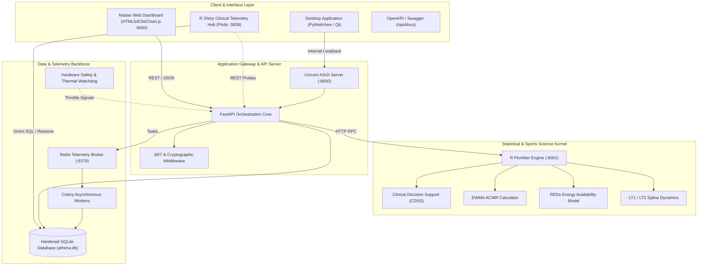

# A.T.H.E.N.A. — Adaptive Telemetry, Health & Evidence-Based Nutrition Analytics

[](LICENSE)
[](https://www.python.org/)
[](https://www.r-project.org/)
[](https://fastapi.tiangolo.com/)
[](https://olympics.com/)
[](SECURITY.md)

**A.T.H.E.N.A.** is a high-performance, clinical-grade telemetry and sports intelligence platform engineered for elite athletic organizations, national institutes of sport, and clinical exercise physiology laboratories.

By synthesizing **real-time biometrics**, **coupled exponentially weighted moving average (EWMA) load analytics**, **dual-threshold metabolic kinetics (LT1/LT2)**, and the **IOC 2023 Consensus on Relative Energy Deficiency in Sport (REDs)**, ATHENA delivers evidence-based injury risk stratification, menstrual cycle phase training optimization, and automated return-to-play (RTP) clinical governance.

---

## 🏛 Architectural Topology

ATHENA employs a decoupled, fault-tolerant micro-hybrid architecture bridging asynchronous Python services with a dedicated R statistical computing kernel.



---

## 🔬 Core Sports Science & Physiological Formulations

### 1. Relative Energy Deficiency in Sport (REDs) — IOC 2023 Consensus
Energy Availability (EA) is tracked continuously against lean body mass:

$$\text{EA} = \frac{\text{Energy Intake (EI)} - \text{Exercise Energy Expenditure (EEE)}}{\text{Fat-Free Mass (FFM)}} \quad [\text{kcal} \cdot \text{kg FFM}^{-1} \cdot \text{day}^{-1}]$$

* **Clinical Low EA:** $< 30 \text{ kcal/kg FFM/day}$ (Immediate training restriction protocol triggered)
* **Subclinical Low EA:** $30\text{–}45 \text{ kcal/kg FFM/day}$ (Fueling adjustment & endocrine tracking)
* **Optimal Fueling:** $\ge 45 \text{ kcal/kg FFM/day}$ (Homeostatic endocrine balance)

### 2. Acute:Chronic Workload Ratio (ACWR) — Coupled EWMA
Calculated via Exponentially Weighted Moving Averages to avoid the spurious inflation inherent to rolling averages:

$$\text{EWMA}_{\text{today}} = \text{Load}_{\text{today}} \cdot \lambda_a + \left( (1 - \lambda_a) \cdot \text{EWMA}_{\text{yesterday}} \right)$$

$$\lambda = \frac{2}{N + 1} \quad (N_{\text{acute}} = 7 \text{ days}, \quad N_{\text{chronic}} = 28 \text{ days})$$

* **Optimal "Sweet Spot":** $0.80 \le \text{ACWR} \le 1.30$
* **High Injury Risk Spike:** $\text{ACWR} > 1.50$

### 3. Dual-Threshold Blood Lactate Kinetics
Automated estimation of aerobic ($\text{LT}_1$, $\sim 2.0\text{ mmol/L}$) and anaerobic/OBLA ($\text{LT}_2$, $\sim 4.0\text{ mmol/L}$) transition markers utilizing third-order B-spline interpolation and the modified D-max geometric curve method.

### 4. Female Athlete Phasic Periodization
* **Early Follicular (Days 1–5):** Baseline estrogen & progesterone; standard substrate utilization.
* **Late Follicular / Ovulatory (Days 10–14):** Estrogen surge; collagen laxity alert (elevated non-contact ACL strain probability).
* **Mid-Luteal (Days 20–24):** Progesterone peak; elevated basal core temperature ($+0.3\text{–}0.5^\circ\text{C}$), enhanced lipid oxidation, elevated cardiovascular strain in thermal environments.

---

## 🌐 Multilingual Internationalization (i18n)

The platform provides native, scientific translation across **10 global languages** (163 localized medical and physiological terms per locale):

| Code | Language | Native Name | Script / Direction |
| :---: | :--- | :--- | :--- |
| `en` | English | English | LTR |
| `hi` | Hindi | हिन्दी | LTR (Devanagari) |
| `es` | Spanish | Español | LTR |
| `fr` | French | Français | LTR |
| `de` | German | Deutsch | LTR |
| `pt` | Portuguese | Português | LTR |
| `ar` | Arabic | العربية | **RTL (Bidirectional)** |
| `ru` | Russian | Русский | LTR (Cyrillic) |
| `sw` | Swahili | Kiswahili | LTR |
| `zh` | Chinese | 中文 (简体) | LTR (Hanzi) |

---

## 🚀 Quickstart & Dual-Console Launch

### Native Installation (Linux / macOS)

#### Prerequisites
* Python 3.12+ or 3.13+
* R 4.4+ with `shiny`, `plotly`, `RSQLite`, `plumber`
* SQLite3 or PostgreSQL 15+

#### Setup
```bash
# Clone the repository
git clone https://github.com/mishra-sportsci/ATHENA.git
cd ATHENA

# Initialize Python virtual environment
python3 -m venv athena_env
source athena_env/bin/activate
pip install -r requirements.txt

# Seed synthetic testing database (Zero Real PII)
python3 seed_demo_data.py
```

#### Launching Operational Consoles
```bash
# Option A: Master FastAPI Web Application & API Gateway (:8000)
./athena.sh

# Option B: Elite R Shiny Clinical Telemetry Hub (:3838)
./run_shiny.sh

# Immediate Resource Clean Shutdown (0.00% background consumption)
./stop.sh
```

* **Master Web Console:** [http://localhost:8000](http://localhost:8000)
* **R Shiny Clinical Hub:** [http://localhost:3838](http://localhost:3838)
* **OpenAPI Documentation:** [http://localhost:8000/api/docs](http://localhost:8000/api/docs)

---

### Native Installation (Windows 10 / 11 — 100% Free of Cost)

ATHENA runs natively on Windows with **zero virtual machines, zero subscriptions, and zero license costs**.

#### 1. Free Prerequisites
* **Python 3.12+ (Free):** [python.org/downloads/windows](https://www.python.org/downloads/windows/) *(Check "Add python.exe to PATH")*
* **R 4.4+ (Free):** [CRAN Windows Installer](https://cran.r-project.org/bin/windows/base/)

#### 2. Automated 1-Click Setup
In Windows Explorer or Command Prompt:
```cmd
deploy\windows\setup_windows.bat
```

#### 3. 1-Click Launch
Double-click **`run_shiny.bat`** in the repository root. Your browser will automatically open the Clinical Hub at **http://127.0.0.1:3838**.
*(To cleanly shut down, run `deploy\windows\stop_windows.bat` or press Ctrl+C).* For advanced options, see the [Windows Guide](deploy/windows/README.md).

---

### Docker Compose Deployment
```bash
cp .env.example .env
touch athena.db .athena_encryption_key
docker compose up -d --build
```

---

### Optional Linux Desktop Shortcuts & Service
Launchers for KDE Plasma, GNOME, and systemd are organized under [`deploy/linux/`](deploy/linux/).
```bash
cp deploy/linux/*.desktop ~/.local/share/applications/
```

---

## 📚 Documentation & Media Assets

* **[ATHENA Clinical User Manual](docs/ATHENA_V1_USER_MANUAL.md)** ([PDF Version](docs/ATHENA_V1_USER_MANUAL.pdf))
* **[Clinical Architecture Guide (PDF)](docs/ATHENA_CLINICAL_ARCHITECTURE_GUIDE.pdf)**
* **[Disaster Recovery Runbook](docs/RECOVERY.md)**
* **[Windows 10/11 Deployment Guide](deploy/windows/README.md)**
* **[Linux Systemd & Desktop Integration](deploy/linux/README.md)**
* **[Official 4K UHD Promotional Videos](media/videos/)** (16:9 Landscape, 9:16 Story, 1:1 Square)

---

## 🔒 Security & HIPAA/GDPR Compliance

* **Zero Real PII in Repository:** This codebase contains only synthetic, anonymized time-series datasets.
* **AES-256 Field-Level Encryption:** Athlete personal identification records are encrypted at rest using Galois/Counter Mode (AES-GCM).
* **Role-Based Access Control (RBAC):** Granular separation of concerns across `Head Coach`, `Sports Scientist`, `Team Physician`, and `Athlete`.

For full compliance and vulnerability disclosure, see [SECURITY.md](SECURITY.md).

---

## 📄 License & Academic Citation

Distributed under the **GNU General Public License v3.0 (GPL-3.0)**. See [LICENSE](LICENSE) for details.

If utilizing A.T.H.E.N.A. in clinical trials, sports science research, or computational modeling, please cite:

```bibtex
@software{mishra2026athena,
  author = {Mishra, Abhishek},
  title = {A.T.H.E.N.A.: Adaptive Telemetry, Health & Evidence-Based Nutrition Analytics},
  year = {2026},
  version = {1.0.0},
  publisher = {GitHub},
  url = {https://github.com/mishra-sportsci/ATHENA}
}
```
